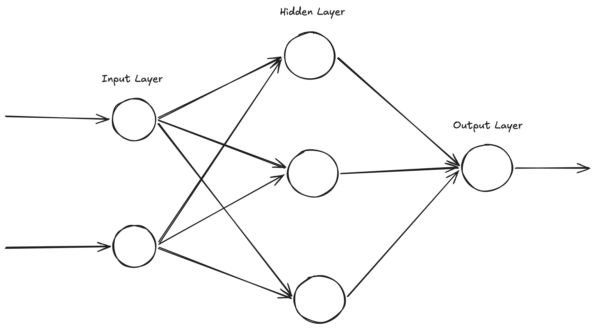
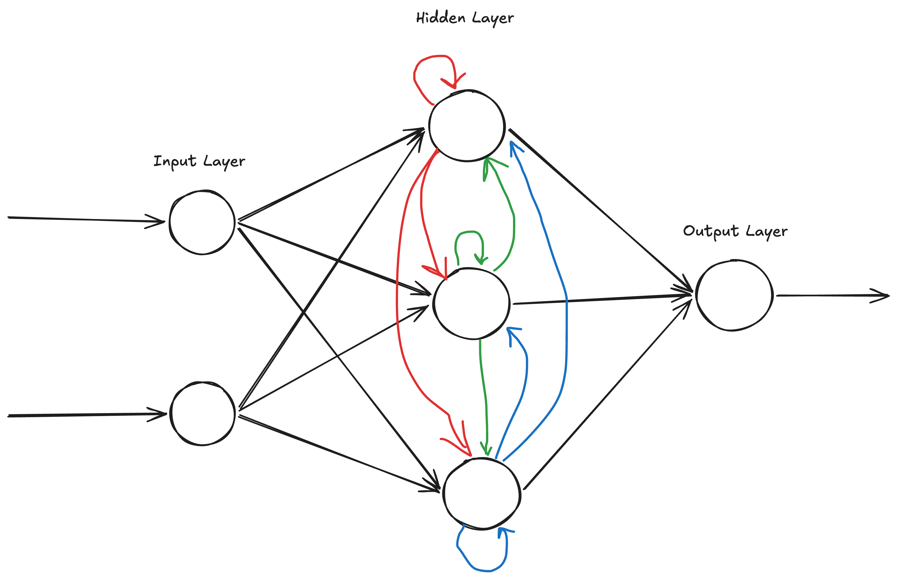
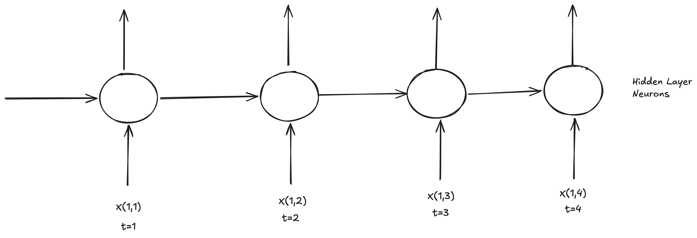

# Chapter 11: Deep Learning for NLP

## Intro to NLP in Deep Learning

In Machine Learning, we mostly worked with the Text Data, which we converted to vectors (numerical representations). We learnt multiple techniques to perform this tasks like: One Hot Encoding, Bag of Words, TF-IDF, Word2Vec, Average Word2Vec, etc. Text Data is considered as sequential data.

### Artificial Neural Network

We use Artificial Neural Networks (ANN) to perform classification or regression. Here, we usually have a tabular data where we have an output column (dependant variable) and multiple input columns (independent variables or features). For example: House Price Prediction. Here, the sequence of data does not matter.

In case of ANN, lets say we have an input layer, we will have a hidden layer (we can have multiple hidden layers) and an output layer. All these layers will be fully connected to each other. We initialize all the weights and biases of the neurons in the hidden layer and output layer randomly. Based on the weights, we perform a forward propagation and backward propagation. Once we get an output, we calculate the loss. Our main aim during training is to reduce the loss, for which we need to change all the weights. This change of weights happens during back-propagation.

In CNNs, we usually deal with images or videos as our data. Mostly we use it for image classification, object detection

---

Now we will talk about data that is sequential in nature (sequential data). We are already familiar with sequential data since we worked with text data. Some of the operations that we perform with sequential data are text generation, chatbot conversations, language translation, auto suggestions etc. Timeseries data is also an example of sequential data where we perform forecasting operations.

In order to work with a neural network using sequential data, we cannot use ANNs.

## ANN vs RNN

Let's consider the problem statement of sentiment analysis on the following dataset:

<!-- Text                 Output
The food is good         1
The food is bad          0
The food is not good     0 -->

Since this is a text data, here the sequence information is important. In case of sequential data, it is a good practice, to give input of words one by one, rather than giving all the words of a sentence as an input. If we give all words in one single inputs, we will loose sequence information.

### Using ANN

First we need to perform text-preprocessing, where we convert text into vectors. Here, regardless of whatever algorithm we use to convert the text to vectors, we will not be preserving the sequence information. Therefore, if we are using ANNs here in this use case, then the meaning of the sentences will be lost.

### Using RNN (Recurrent Neural Network)

In an RNN, we have a feedback loop present in it, which helps us to preserve the sequence information. This can be thought of as a hidden state from the previous time step which is fed into the current time step. So, whatever is the output of a neuron in a hidden layer, that is shared with all the other neurons in that hidden layer.
So, our sentence is denoted as X(ij), where i denotes the sentence number and j denotes the word number in the sentence.
The input to an RNN is given as

at t=0, we give the first word of the sentence, i.e. X(i1)
at t=1, we give the second word of the sentence, i.e. X(i2)
at t=2, we give the third word of the sentence, i.e. X(i3)  
and so on...
The hidden state at time t=j is denoted as h(ij)

h(i0) = tanh(W(ih) _ X(i1) + b)
h(i1) = tanh(W(ih) _ X(i2) + h(i0))
h(i2) = tanh(W(ih) \* X(i3) + h(i1))
and so on...

h(it) = tanh(W(ih) _ X(it) + W(hh) _ h(it-1) + b)

Here W(ih) is the weight matrix for the input, W(hh) is the weight matrix for the hidden state and b is the bias vector.

So, at any given point of time, the RNN's hidden neuron holds the context from the previous words as well. It can be understood from the following diagram

