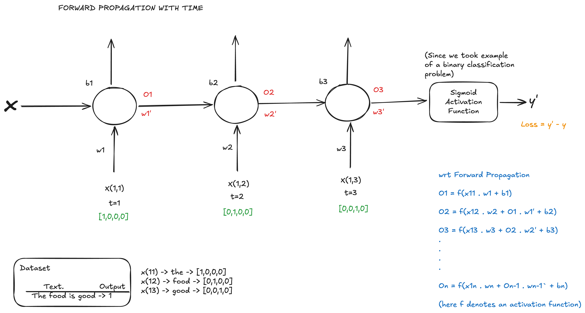

# Simple RNN Indepth Intuition

## RNN Forward Propagation with time

Let us consider the following dataset:

<!--
    Text                Output
The food is good            1
The food is bad             0
The food is not good        0

-->

We have these unique words in the dataset: [the, food, good, bad, not]
First, we would have to convert the words to vectors. Once we have converted the words to vectors, we will take up a simple RNN. We will be giving one word at a time, as input, to our RNN. The number of neurons in the input layer, will be equal to the dimensions in the vector representation of the word.
Lets say we have 3 neurons in the hidden layer. At t=1, when we pass the word "the" as input to the RNN (X11), then the hidden layer neurons, using the feedback loop, passes the values to the other neurons at t=2, when the input is (X12). So, at t=2, the RNN has context to both the words X11(the) and X12 (food).

We can understand the forward propagation better using the following example:

