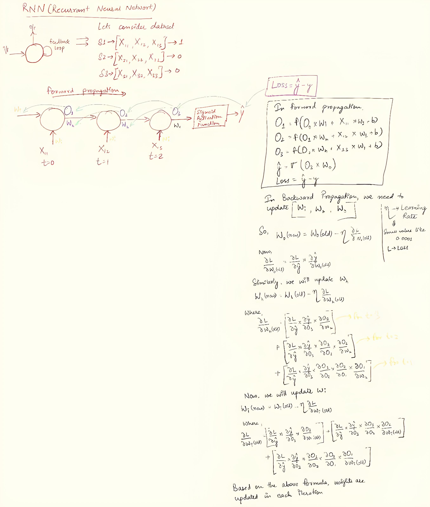

# Simple RNN Indepth Intuition

## RNN Forward Propagation with time

Let us consider the following dataset:

<!--
    Text                Output
The food is good            1
The food is bad             0
The food is not good        0

-->

We have these unique words in the dataset: [the, food, good, bad, not]
First, we would have to convert the words to vectors. Once we have converted the words to vectors, we will take up a simple RNN. We will be giving one word at a time, as input, to our RNN. The number of neurons in the input layer, will be equal to the dimensions in the vector representation of the word.
Lets say we have 3 neurons in the hidden layer. At t=1, when we pass the word "the" as input to the RNN (X11), then the hidden layer neurons, using the feedback loop, passes the values to the other neurons at t=2, when the input is (X12). So, at t=2, the RNN has context to both the words X11(the) and X12 (food).

We can understand the forward propagation better using the following example:

## RNN Backward Propagation with time

So, in the previous section, we saw how the information flows from t=1 -> t=2 ... up to t=n. We get an output from the RNN which we call as y' (pronounced y-hat). Once the output is received, we calculate the loss (depending upon the loss function, we calculate the loss accordingly).

Our ultimate goal is to minimize this loss function, and as we know, we can minimize the loss function using the gradient descent algorithm. In order to reduce the loss, we need to perform a back propagation and update the weights.

In forward propagation, first we calculate O1. Also, each neuron will have an activation function.

O1 = f(X(i1) x W1 + O0 x Wh + b1)
O2 = f(X(i2) x W2 + O1 x Wh + b2)
.
.
.
On = f(X(in) x Wn + O(n-1) x Wh + bn)

Once we have the output On, we can calculate the loss:
Loss = y - y'

Our main aim is to reduce this loss, and it can be done only if we update all the weights such that y' is close to y. In our case, we will need to update 3 weights (considering there is only 1 neuron in RNN, Wi (weight of input layer), Wh (weight of hidden layer), Wo (weight of output layer)).

In Back Propagation, we update [Wi, Wh, Wo]. These weights are updated, until we reach the global minima for the loss.

We can understand how weights are updated with the help of the following image

## Problems with RNN

So RNNs also have some drawbacks because of which we would be learning about 2 more types of RNNs:

1. LSTM
2. GRU

However, before proceeding to the above RNNs, we will understand the problems associated with the current RNN.

Just like ANNs, we also face `vanishing gradient problem` in RNNs as well.

### Vanishing Gradient Problem

During the previous topics, the sentences in the datasets that we selected, were very small. Let us consider the use-case of text-generation, where we have to generate text.

In a text generation, the prediction of the next word depends on all of the previous words of the sentence. In case of short sentences, things are normal, but when there is a very long sentence, the prediction of the next word depends on all of the previous words of the sentence. Also, all the words will be passed to the RNN one-by-one. This creates the following problems:

1. The long term dependencies cannot be captured by RNNs. Therefore, RNNs are not good, when there is long dependency. The equations which we are using to update the hidden weights during back-propagation, will gradually become zero as we proceed with long sentences, so the weights won't update much. This means, the words that are closer to the end, will be impactful, while the ones towards the beginning, will have no impact, which is not ideal.

To fix this issue of `vanishing gradient problem`

1. we can use other activation functions such as `ReLU` or `Leaky ReLU`
2. Use LSTM RNNs
3. Use GRU RNNs
