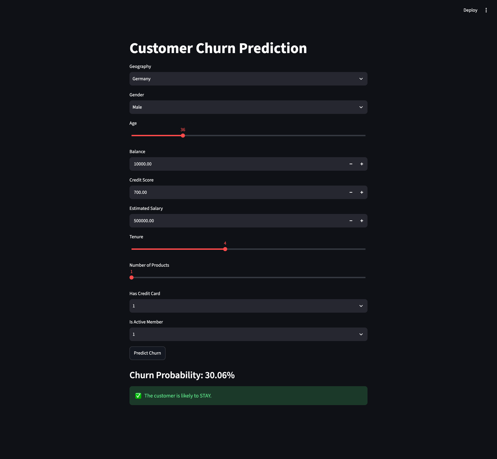

# Project Details

Dataset - Churn Modelling
Binary Classification Problem
Description - Based on the details, we need to train a model, to predict if a customer is going to churn, i.e. leave the company or not.

## Operations

Load Dataset -> Perform Basic Feature Engineering (Convert categories to numbers, Standardization, etc) -> Create ANN -> Apply dropouts -> Store model as pickle file -> Use streamlit to create web-app and integrate model -> Deploy on Streamlit Cloud

